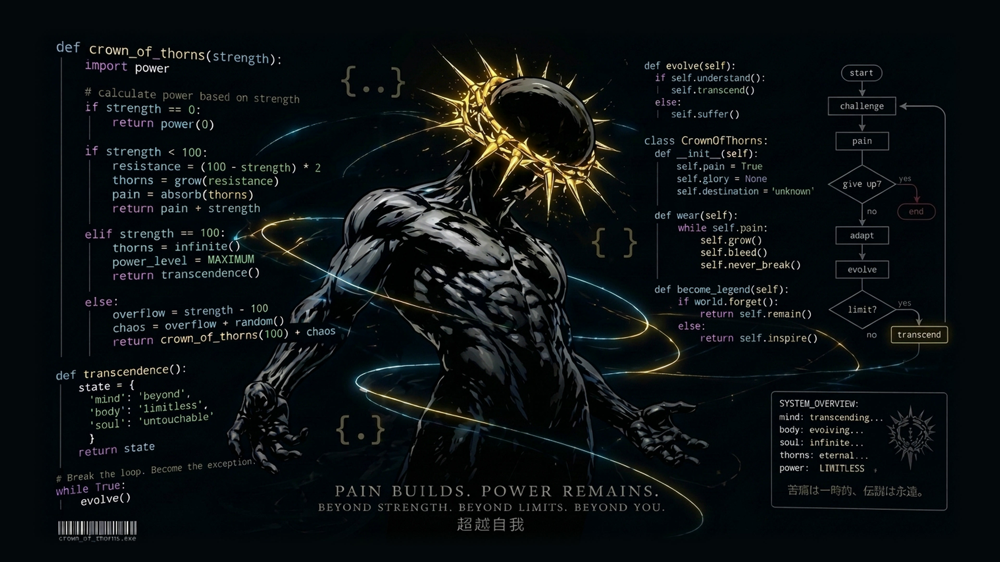
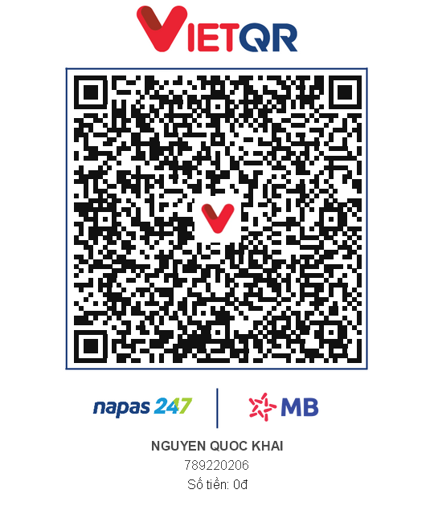

# Antigravity Theme Injector (`theme-antigravity`)

Công cụ tiêm giao diện (**Theme Injector**) chạy bằng **Node.js thuần** (không cần `npm install`), sử dụng **Chrome DevTools Protocol (CDP)** để thay ảnh nền 4K và hiệu ứng kính mờ (**Glassmorphism**) cho ứng dụng **Antigravity** khi đang chạy.

- **Không sửa file gốc của Antigravity:** Không đụng chạm vào `app.asar` hay mã nguồn cài đặt. Khi tắt app và mở lại bình thường (không kèm cờ debug), giao diện quay về nguyên bản 100%.
- **Không tràn viền, sắc nét 4K:** Tích hợp sẵn ảnh nền `3840 × 2160` (`assets/wallpaper-4k.jpg`) với chế độ `contain` + lề trên tránh thanh menu (`framePadding`), hiển thị trọn vẹn nội dung ở mọi kích thước cửa sổ.
- **Kính mờ & tự động giữ tương phản chữ:** Tự nhận diện panel chính (trong suốt), sidebar/thanh trên/khung chat (kính mờ `backdrop-filter`), bỏ qua nút bấm, code block (`<pre>`, `<code>`) và menu/popup.



---

## Yêu cầu hệ thống

- **Node.js `>= 22.0.0`** (sử dụng `fetch` và `WebSocket` tích hợp sẵn của Node 22, không cần cài thư viện ngoài).
- Ứng dụng **Antigravity Desktop** (Windows, macOS hoặc Linux).

Kiểm tra nhanh phiên bản Node.js trên máy:

```bash
node -v
```

---

## Cài đặt

Clone repository về máy:

```bash
git clone https://github.com/ngoisaocodon2202/theme-antigravity.git
cd theme-antigravity
```

Kiểm tra cấu hình & bộ test trước khi chạy:

```bash
npm run build
```

---

## Hướng dẫn cài & tiêm theme chi tiết

### Bước 1: Đóng hoàn toàn Antigravity đang chạy
- Đóng tất cả cửa sổ Antigravity.
- **Trên Windows:** Nhớ kiểm tra biểu tượng Antigravity ở **khay hệ thống (System Tray)** góc dưới bên phải màn hình và thoát hẳn (`Quit`/`Exit`) nếu app vẫn chạy ngầm. Nếu còn tiến trình cũ chạy ngầm, lần mở tiếp theo sẽ không kích hoạt được cổng CDP.

### Bước 2: Mở lại Antigravity kèm cổng CDP `9000`
> **Lưu ý quan trọng:** Không dùng cổng `9222` vì Antigravity sử dụng sẵn `9222` cho trình duyệt nội bộ (dễ gây lỗi `HTTP 404`). Hãy dùng cổng **`9000`** (hoặc đổi sang cổng trống khác như `9003` rồi truyền `--port 9003`).

**Windows (PowerShell):**

```powershell
Start-Process "$env:LOCALAPPDATA\Programs\antigravity\Antigravity.exe" -ArgumentList "--remote-debugging-port=9000", "--remote-allow-origins=*"
```

**macOS (Terminal):**

```bash
open -a Antigravity --args --remote-debugging-port=9000 --remote-allow-origins=*
```

**Linux (Terminal):**

```bash
antigravity --remote-debugging-port=9000 --remote-allow-origins=*
```

*(Mẹo: Trong Antigravity, nên mở **Settings** (`Ctrl + ,` / `Cmd + ,`) → **Appearance** → chọn **Dark** để icon và màu chữ đồng bộ tự nhiên nhất với ảnh nền tối.)*

### Bước 3: Chạy lệnh tiêm theme
Đợi cửa sổ Antigravity hiện lên hoàn chỉnh, rồi chạy tại thư mục `theme-antigravity`:

```bash
node inject.js
```

Khi thấy thông báo `[OK] Đã tiêm theme -> "..."` là giao diện đã được áp dụng ngay lập tức!

---

## Các lệnh sử dụng nâng cao

| Lệnh | Công dụng |
| :--- | :--- |
| `node inject.js` | Tiêm theme theo cấu hình trong `theme.config.json` |
| `node inject.js --image "duong-dan-anh.png"` | Tiêm nhanh một ảnh nền bất kỳ (`.jpg`, `.png`, `.webp`, `.gif`, `.avif`, `.svg`) |
| `node inject.js --port 9003` | Kết nối tới cổng CDP tùy chọn (nếu bạn mở app với cổng khác `9000`) |
| `node inject.js --watch` | Theo dõi thay đổi của `theme.config.json` hoặc file ảnh và cập nhật nóng tức thì |
| `node inject.js --reset` | Gỡ bỏ theme khỏi cửa sổ đang mở và khôi phục giao diện mặc định |
| `node inject.js --title "Antigravity"` | Chỉ tiêm vào cửa sổ có tiêu đề hoặc URL chứa chuỗi chỉ định |
| `node inject.js --dry-run` | Kiểm tra cấu hình và dung lượng payload mà không cần mở cổng CDP |
| `node inject.js --help` | Xem hướng dẫn đầy đủ các tham số CLI |

---

## Tùy chỉnh theme trong `theme.config.json`

Bạn có thể chỉnh trực tiếp file `theme.config.json`:

```json
{
  "host": "127.0.0.1",
  "port": 9000,
  "wallpaperPath": "./assets/wallpaper-4k.jpg",
  "backgroundColor": "#03080C",
  "backgroundSize": "contain",
  "backgroundPosition": "center center",
  "framePadding": "48px 12px 12px 12px",
  "overlayColor": "rgba(3, 8, 12, 0.22)",
  "backdropBlur": "14px",
  "glassSurfaceColor": "rgba(12, 16, 24, 0.48)",
  "glassBorderColor": "rgba(255, 255, 255, 0.14)",
  "forceLightText": true,
  "targetTitleFilter": ""
}
```

- **`wallpaperPath`**: Đường dẫn tới ảnh nền (tương đối theo thư mục repo hoặc đường dẫn tuyệt đối).
- **`backgroundSize`**:
  - `"contain"` *(mặc định)*: Giữ trọn 100% ảnh bên trong khung, không bị cắt mép/tràn viền.
  - `"cover"`: Phóng kín toàn khung (phù hợp với ảnh phong cảnh không có chữ ở sát mép).
- **`backgroundColor`**: Màu nền lấp khoảng trống quanh ảnh khi dùng `contain` (nên đặt trùng màu viền ảnh).
- **`framePadding`**: Khoảng cách chừa viền (`top right bottom left`), mặc định chừa `48px` phía trên để thanh menu Antigravity không che mất ảnh.
- **`overlayColor`**: Lớp phủ tối nhẹ giúp chữ trắng nổi bật, dễ đọc hơn.
- **`backdropBlur` / `glassSurfaceColor` / `glassBorderColor`**: Độ mờ và màu kính cho sidebar, thanh trên và khung nhập chat.
- **`forceLightText`**: Đặt `true` để tự chuyển chữ tối sang sáng nếu bạn đang dùng giao diện Light mode.

### Mẹo chọn ảnh nền đẹp
- Ưu tiên ảnh có độ phân giải **16:9** từ **Full HD (`1920 × 1080`)** đến **4K (`3840 × 2160`)** để không bị vỡ khi hiển thị toàn màn hình.
- Nếu ảnh có chữ/đồ họa sát mép, hãy để `"backgroundSize": "contain"` và chỉnh `"backgroundColor"` trùng với màu nền ngoài của ảnh.

---

## Khắc phục sự cố thường gặp

1. **Lỗi `CDP endpoint trả về HTTP 404 tại http://127.0.0.1:9222/json/list`:**
   - Cổng `9222` bị trình duyệt nội bộ của Antigravity giữ sẵn. Hãy đổi sang cổng **`9000`** khi khởi chạy Antigravity và trong `theme.config.json`.
2. **Lỗi `Không kết nối được cổng CDP 127.0.0.1:9000`:**
   - Trước khi chạy lệnh mở Antigravity kèm `--remote-debugging-port=9000`, ứng dụng vẫn còn chạy ngầm (kiểm tra Task Manager / System Tray trên Windows và đóng hết tiến trình `Antigravity.exe` rồi mở lại).
3. **Nền chữ chưa đổi sang sáng hoàn toàn:**
   - Chuyển theme gốc trong Antigravity sang **Dark** (`Settings > Appearance > Dark`).

---

## Cấu trúc mã nguồn

```text
theme-antigravity/
├── assets/
│   ├── wallpaper-4k.jpg    # Ảnh nền mặc định 4K (3840x2160)
│   └── donate-qr.png       # Mã QR VietQR MBBank ủng hộ tác giả
├── src/
│   ├── cdpClient.mjs       # Giao tiếp HTTP/WebSocket qua Chrome DevTools Protocol
│   ├── clientPayload.mjs   # Sinh CSS/DOM injector & reset script chạy trong renderer
│   └── config.mjs          # Đọc cờ CLI, cấu hình JSON và mã hóa ảnh Base64
├── test/
│   └── injector.test.mjs   # Bộ unit & integration test với mock CDP WebSocket
├── inject.js               # File CLI chính
├── theme.config.json       # Cấu hình mặc định
├── package.json
├── LICENSE
└── README.md
```

---

## Ủng hộ tác giả (Donate)

Nếu công cụ này giúp góc làm việc của bạn đẹp và có cảm hứng hơn, bạn có thể mời tác giả một ly cà phê qua **MBBank**:

- **Ngân hàng:** MBBank (Ngân hàng TMCP Quân Đội)
- **Số tài khoản:** `789220206`
- **Chủ tài khoản:** `NGUYEN QUOC KHAI`

<p align="left">
  
</p>

Cảm ơn bạn đã sử dụng và chia sẻ **theme-antigravity**!
